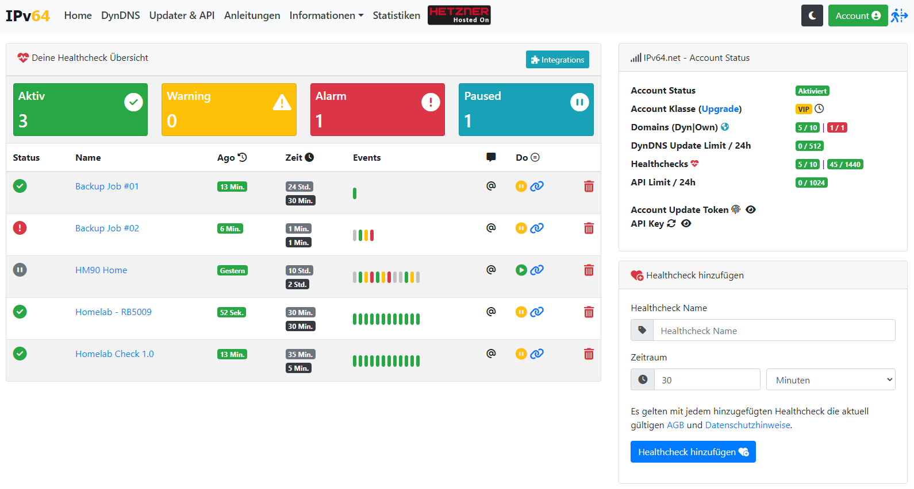

# Node64

Ein leichtgewichtiger Docker-Container für das Heimnetz: Healthchecks (als Uptime-Kuma-Alternative), DynDNS-Updater für ipv64, später Reverse-Proxy, standalone oder verknüpft mit einem [ipv64.net](https://ipv64.net)-Account.

Ein einziges Go-Binary, SQLite, eingebettete Weboberfläche, keine externen Abhängigkeiten zur Laufzeit. Läuft auf amd64 und arm64, auch auf einem Raspberry Pi.

**Stand: Phase 5 (Betrieb).** Der erste Entwurf ist vollständig: Kern mit Setup, Login, Zwei-Faktor-Anmeldung (TOTP mit Wiederherstellungscodes), API-Keys, Modulsystem, Datenbank mit Migrationen, Backup und Wiederherstellung, Export und Import der Konfiguration, Audit-Log, Logs mit Log-Level je Bereich, Versionsprüfung per Opt-in. Healthchecks mit allen Typen, Scheduler, Oberfläche, Wartungsfenstern und JSON-API. Benachrichtigungen über E-Mail, Telegram, Discord, ntfy, Gotify, Pushover und Webhook. Was ipv64.net für die Verknüpfung bauen muss, steht in [docs/SYNC.md](docs/SYNC.md).

## Benachrichtigungen

Kanäle werden unter *Benachrichtigungen* angelegt und getestet. Standardkanäle bekommen alle Checks, die keine eigene Auswahl haben. Texte gehen in der Sprache des Kanals raus (Deutsch oder Englisch). Geheimnisse wie Bot-Tokens oder SMTP-Passwörter liegen verschlüsselt in der Datenbank, der Schlüssel in `/data/secret.key`.

Webhooks bekommen standardmäßig ein JSON mit `event_id`, `kind` (down, up, flapping_start, flapping_end, reminder, summary, test, dyndns_ip, dyndns_fail, dyndns_limit), `status`, `check` (token, name, type, target), `reason`, `message`, `duration_seconds`, `node` und `url`. Ein eigener Body mit Platzhaltern wie `{{name}}` oder `{{status}}` ist möglich.

Gegen Alarmrauschen wirken Wiederholungen vor Alarm, Stabilisierung, Flatter-Erkennung, Sammelmeldungen ab drei gleichzeitigen Störungen, Ruhezeiten (nur kritische Checks alarmieren) und höchstens 60 Nachrichten je Kanal und Stunde. Links in Nachrichten brauchen die externe Adresse des Nodes in den Einstellungen der Benachrichtigungen.

## Schnellstart

```bash
docker run -d --name node64 \
  -p 8080:8080 \
  -v node64-data:/data \
  --restart unless-stopped \
  ghcr.io/ipv64net/node64:latest
```

Danach `http://<host>:8080` öffnen. Beim ersten Start führt ein Assistent durch Sprache und Admin-Konto. Es gibt kein Standardpasswort.

### docker compose

```yaml
services:
  node:
    image: ghcr.io/ipv64net/node64:latest
    container_name: node64
    restart: unless-stopped
    ports:
      - "8080:8080"
      # - "8443:8443"   # optional HTTPS, dazu NODE64_HTTPS_PORT=8443 setzen
    volumes:
      - node64-data:/data
      # Optional: Docker-Container überwachen (siehe "Docker-Container prüfen")
      # - /var/run/docker.sock:/var/run/docker.sock:ro
    # group_add:
    #   - "996"   # Gruppe des Sockets: stat -c %g /var/run/docker.sock
    environment:
      NODE64_LOG_LEVEL: info
      # NODE64_HTTPS_PORT: 8443
      # NODE64_ADMIN_USER: admin            # nur beim allerersten Start
      # NODE64_ADMIN_PASSWORD: change-me    # nur beim allerersten Start
    read_only: true
    tmpfs:
      - /tmp
    # Für ICMP-Checks ohne Root: unprivilegiertes Ping erlauben
    sysctls:
      - net.ipv4.ping_group_range=0 65535
volumes:
  node64-data:
```

### Docker-Container prüfen

Der Check-Typ **Docker-Container** fragt die Docker-Engine-API nach dem Zustand eines Containers auf demselben Host (nur lesende Anfragen). Dazu braucht die Node Zugriff auf den Socket:

```yaml
    volumes:
      - /var/run/docker.sock:/var/run/docker.sock:ro
    group_add:
      - "996"   # stat -c %g /var/run/docker.sock
```

Bewertung (angelehnt an Uptime Kuma): läuft = OK, läuft mit Healthcheck „healthy“ oder „starting“ = OK, Healthcheck „unhealthy“, gestoppt (mit Exit-Code, OOM), pausiert oder in einer Neustart-Schleife = gestört, nicht vorhanden = gestört. Die Healthchecks-Seite zeigt Docker-Checks in einer eigenen Tabelle und listet Container, die noch nicht überwacht werden, zum Anlegen per Klick.

Docker-Checks laufen nur lokal auf der Node; sie lassen sich nicht online prüfen oder umhängen. Mit ipv64 verknüpft wird ihr Zustand trotzdem gemeldet und ist im Portal sichtbar.

**Sicherheit:** Wer den Docker-Socket hat, kann den Host steuern – auch mit `:ro` (das schützt nur die Datei, nicht die API). Die Node sendet ausschließlich GET-Anfragen. Wer das Risiko begrenzen will, setzt einen [docker-socket-proxy](https://github.com/Tecnativa/docker-socket-proxy) mit `CONTAINERS=1` davor und trägt in der Node `NODE64_DOCKER_HOST=tcp://socket-proxy:2375` ein (oder je Check unter „Docker-Host“).

## Lokale API

Der Node stellt alles, was die Oberfläche kann, auch als JSON-API im eigenen Netz bereit: Status, Module, Einstellungen, Audit-Log, Logs, Backup, Benachrichtigungskanäle und das komplette Healthchecks-Modul. Die Referenz liegt im Node unter `/api/docs`, die maschinenlesbare Beschreibung (OpenAPI 3.1) unter `/api/openapi.json`.

Anmeldung mit einem API-Key aus den Einstellungen (`Authorization: Bearer node64_…`) oder mit der Browser-Sitzung. Ohne Anmeldung erreichbar sind nur `/api/health` (für Docker) und `/api/push/{token}` (Heartbeats).



### Healthchecks per API

Das Modul wird in den Einstellungen aktiviert. Check-Typen: `http`, `keyword`, `icmp`, `tcp`, `port`, `cert`, `push`, `docker`.

Mit ipv64.net verknüpft bilden alle Nodes eines Accounts ein System: `nodes` legt fest, welche Nodes einen Check messen, `owner` zeigt, ob er dieser Node (`self`), einer anderen (`other`) oder nur ipv64 (`online`) gehört. Jede Node darf jeden Check ändern, pausieren, löschen und mit `run` sofort messen lassen. Misst sie ihn nicht selbst, geht der Auftrag über ipv64 an die messenden Nodes. Nur die Messstelle eines Docker-Checks bleibt bei der Node mit dem Container. Ohne Verbindung werden Änderungen gepuffert und nachgeliefert, bei gleichzeitigen Änderungen gewinnt die jüngere.

```bash
# Check anlegen
curl -X POST http://localhost:8080/api/checks -H "Authorization: Bearer node64_…" -H "Content-Type: application/json" -d '{
  "name": "Webseite", "type": "http", "target": "https://example.com/",
  "interval_seconds": 60, "retries": 1, "stabilize": 3,
  "params": {"accept_status": "200-299"}
}'
# Liste, Details, Messpunkte, Ereignisse, Statistik
curl -H "Authorization: Bearer node64_…" http://localhost:8080/api/checks
curl -H "Authorization: Bearer node64_…" "http://localhost:8080/api/checks/<token>/measurements?limit=50"
curl -H "Authorization: Bearer node64_…" "http://localhost:8080/api/checks/<token>/stats?range=24h"
# Diagrammdaten je Messstelle (diese Node, andere Nodes, ipv64-Standorte)
curl -H "Authorization: Bearer node64_…" "http://localhost:8080/api/checks/<token>/chart?range=24h"
# Heartbeat (Push-Check): der Dienst meldet sich selbst
curl http://localhost:8080/api/push/<token>
curl "http://localhost:8080/api/push/<token>?status=down&msg=backup+failed"
curl -X POST --data '{"files": 1200}' http://localhost:8080/api/push/<token>
```

Push-Checks lassen sich an jeder Node und bei ipv64 auslösen. Misst diese Node den Check nicht allein, gibt sie den Push über ipv64 an die anderen messenden Nodes weiter; ist das ohne Verbindung nicht möglich, antwortet sie mit 503.

Weitere Endpunkte: `PUT`/`DELETE /api/checks/{token}`, `POST .../pause|resume|run|clone`, `GET .../events|incidents|chart`, `GET /api/events`, `GET /api/incidents`, `GET|POST /api/maintenance`, `PUT|DELETE /api/maintenance/{id}`, `GET|POST /api/channels`, `POST /api/channels/{id}/test`, `GET /api/status`, `GET|PUT /api/settings`, `GET /api/backup`. Alles mit Parametern und Antworten unter `/api/docs`.

ICMP-Checks brauchen im Container entweder unprivilegiertes Ping (`sysctls: net.ipv4.ping_group_range=0 65535`, siehe compose oben) oder `cap_add: NET_RAW`.

## DynDNS-Updater

Das Modul *DynDNS* (in den Einstellungen einschalten) hält ausgewählte Domains und Records bei ipv64 mit der öffentlichen Adresse des Anschlusses aktuell. Ausgeschaltet läuft nichts.

- **ipv64-API-Key:** einmal unter *Einstellungen → ipv64-API-Key* eintragen (verschlüsselt gespeichert, mit Ablaufdatum). Damit wählst du unter *DynDNS → Ziel hinzufügen* die Namen aus deinem Account und je Name, was aktualisiert wird. Ohne Key lassen sich Ziele von Hand mit Token anlegen.
- **Sicherster Token:** Die Updates laufen nie mit dem API-Key, sondern mit dem Record-Token des Namens (sonst Domain-Token), im HTTP-Header.
- **Nur bei Änderung:** Die Node ermittelt ihre öffentliche IPv4/IPv6 über `ipv4.ipv64.net` bzw. `ipv6.ipv64.net` (alle 5 min, einstellbar) und fragt die ipv64-Nameserver direkt, was sie ausliefern. `update.php` wird nur bei einer Abweichung aufgerufen, denn auch `nochg` zählt auf das Tageslimit. Zwischen zwei Aufrufen liegen mindestens 5 s; Cooldown, Tageslimit, ungültiger Token, Konflikte und Records, die woanders ständig anders gesetzt werden, pausieren statt Limit zu verbrauchen.
- **IPv6-Modi:** Adresse dieses Hosts, nur Präfix (zonenweit, für Records mit Interface-ID wie `::1:2:3:4`), Präfix + eigene Interface-ID (nur dieser Record, stabil trotz Privacy-Adressen), Interface (stabile Adresse, nur mit `network_mode: host`), fest oder aus.
- **Router-IP:** Bei IPv4 sieht ipv64 automatisch die Adresse des Routers, nie die interne Container-Adresse. Bei IPv6 gibt es kein NAT: ohne IPv6 im Docker-Netz zeigt die Seite einen Hinweis (siehe [IPv4 und IPv6](#ipv4-und-ipv6)). Deuten die ersten Stationen ins Internet auf CGNAT (100.64.0.0/10) oder DS-Lite (192.0.0.1) hin, erscheint ein Hinweis mit Links zu ipv64.
- **Verlauf und Limit:** Jede Prüfung und jeder Aufruf steht im Verlauf (Aufbewahrung einstellbar). Mit API-Key zeigt die Seite das Update-Limit des Accounts. Benachrichtigungen (Adresswechsel, Fehler, Limit) gehen an die Standardkanäle, auch bei verknüpfter Node, nicht in der Ruhezeit.
- **API und Export:** `GET /api/dyndns/status`, `GET|POST /api/dyndns/targets`, `GET|PUT|DELETE /api/dyndns/targets/{id}`, `POST /api/dyndns/targets/{id}/update`, `POST /api/dyndns/check`, `GET /api/dyndns/history`. Der Export enthält Ziele und Einstellungen ohne Tokens; der Import holt sie mit dem API-Key neu.

## Betrieb

- **Backup:** Unter *Einstellungen* lässt sich die Datenbank im laufenden Betrieb konsistent herunterladen und aus einer Datei wiederherstellen. Nach der Wiederherstellung startet der Node neu (Docker startet ihn mit `restart: unless-stopped` automatisch), die alte Datenbank bleibt unter `/data/backups`. Vor jeder Migration entsteht dort ebenfalls ein Backup.
- **Zurücksetzen:** Unter *Einstellungen → Über* setzt *Node zurücksetzen* (Passwort und Rückfrage) den Node auf den Auslieferungszustand: eine Verknüpfung mit ipv64 wird getrennt, nach dem Neustart ist `/data` leer (Datenbank, Schlüssel, Zertifikat, Backups) und die Einrichtung beginnt neu. Ein eigenes Zertifikat (`NODE64_TLS_CERT`/`NODE64_TLS_KEY`) unter `/data` bleibt erhalten. Bewusst nur in der Oberfläche, nicht per API-Key.
- **Export und Import:** Die Konfiguration (Checks, Wartungsfenster, Kanäle, Einstellungen) als JSON, wahlweise ohne Geheimnisse oder mit Passwort verschlüsselt. Der Import gleicht Checks über den Token und Kanäle über den Namen ab und löscht nichts.
- **Zwei-Faktor-Anmeldung:** TOTP mit jeder Authenticator-App, acht Wiederherstellungscodes.
- **API-Keys:** Für Skripte gegen die lokale API, `Authorization: Bearer node64_...`. Keys werden nur einmal angezeigt und gehasht gespeichert.
- **Schutz:** Login-Ratelimit, Ratelimit je IP für alle Anfragen, Push-URLs mit Mindestabstand, höchstens 60 Nachrichten je Kanal und Stunde.
- **Updates:** Optional prüft der Node täglich eine Versionsdatei bei ipv64.net. Es werden keine Daten gesendet.

## IPv4 und IPv6

Der Node ist durchgehend Dual-Stack: die Oberfläche lauscht auf IPv4 und IPv6, jeder Check hat einen Modus (`auto`, `ipv4`, `ipv6`, `both` = zwei getrennte Ergebnisse), ICMP pingt v4 und v6, Benachrichtigungen und die spätere ipv64-Verknüpfung nutzen beides. Vor jedem Check prüft der Node, ob die jeweilige Adressfamilie im Container überhaupt erreichbar ist, damit ein fehlendes IPv6 im Docker-Netz nicht als Störung des Ziels gemeldet wird.

Docker gibt Containern standardmäßig **kein IPv6**. Damit Checks per IPv6 laufen, dem Netz IPv6 geben (Docker 27+, compose):

```yaml
networks:
  default:
    enable_ipv6: true
    ipam:
      config:
        - subnet: fd00:64::/64   # ULA, Docker übernimmt NAT66
```

Alternativ `network_mode: host`. `net.ipv4.ping_group_range` gilt trotz des Namens auch für ICMPv6.

## Umgebungsvariablen

| Variable | Standard | Bedeutung |
| --- | --- | --- |
| `NODE64_DATA_DIR` | `/data` | Einziges beschreibbares Verzeichnis: Datenbank, Backups, Schlüssel, Zertifikat |
| `NODE64_HTTP_PORT` | `8080` | Port der Oberfläche, `0` = aus |
| `NODE64_HTTPS_PORT` | `0` | Port für HTTPS mit selbstsigniertem Zertifikat, `0` = aus |
| `NODE64_BIND_ADDR` | leer (alle) | Bind-Adresse |
| `NODE64_TLS_CERT` / `NODE64_TLS_KEY` | leer | Eigenes Zertifikat statt des selbstsignierten |
| `NODE64_LOG_LEVEL` | `info` | `debug`, `info`, `warn`, `error`; zur Laufzeit im UI änderbar |
| `NODE64_LOG_FORMAT` | `text` | `text` oder `json` |
| `NODE64_ADMIN_USER` / `NODE64_ADMIN_PASSWORD` | leer | Admin beim allerersten Start anlegen; danach ignoriert |
| `NODE64_TRUST_PROXY` | `false` | `X-Forwarded-For` auswerten, nur hinter eigenem Reverse Proxy |

## Sicherheit

- Laufzeit-Image `FROM scratch`: kein OS, keine Shell, nur das Binary. Nicht-Root (UID 65532), Root-FS read-only, nur `/data` beschreibbar.
- Passwörter mit argon2id, Sitzungen in der Datenbank, CSRF-Schutz, Login-Ratelimit, Security-Header, Content-Security-Policy ohne externe Quellen.
- Geheimnisse (später Kanal-Tokens, SMTP-Passwörter) werden mit einem Schlüssel aus `/data/secret.key` verschlüsselt. Im Log werden sie maskiert.
- Vor jeder Datenbank-Migration wird automatisch ein Backup nach `/data/backups` geschrieben.
- Keine Telemetrie. Versionsprüfung gegen ipv64 nur nach Opt-in (folgt).

## Entwicklung

Voraussetzung: Go 1.27 oder neuer. Kein CGO nötig.

```bash
make build          # Binary nach bin/node64
make test           # Tests
make run            # lokal mit ./data und Debug-Log
make docker         # Image für die eigene Architektur
make docker-multiarch PUSH=--push   # amd64 + arm64 über buildx
```

Projektstruktur:

```
cmd/node64/         main, Subcommands (healthcheck, version)
internal/checks/    Check-Bot (Phase 2), ohne Abhängigkeit zu web/store/scheduler/notify
internal/scheduler/ Intervalle, Retry, Worker-Pool, Zustandsautomat (Phase 2)
internal/store/     SQLite, Migrationen je Scope, Backups
internal/notify/    Benachrichtigungskanäle (Phase 4)
internal/web/       Handler, Templates, Sessions, Static (alles eingebettet)
internal/module/    Modulsystem mit Start/Stop zur Laufzeit
internal/i18n/      Sprachdateien de und en
internal/sync/      Stub für die spätere ipv64-Anbindung
internal/config/    Umgebungsvariablen
internal/logging/   slog mit Laufzeit-Level, Ringpuffer und Maskierung
```

## Lizenz

Apache-2.0, siehe [LICENSE](LICENSE).
